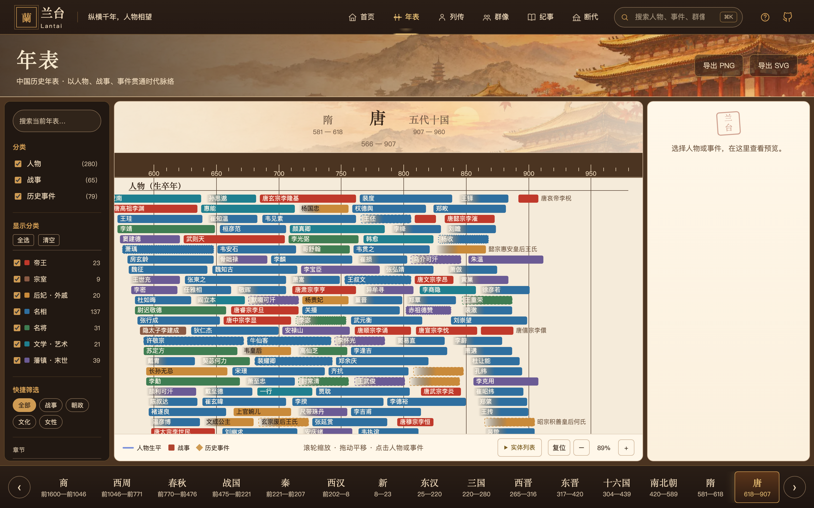
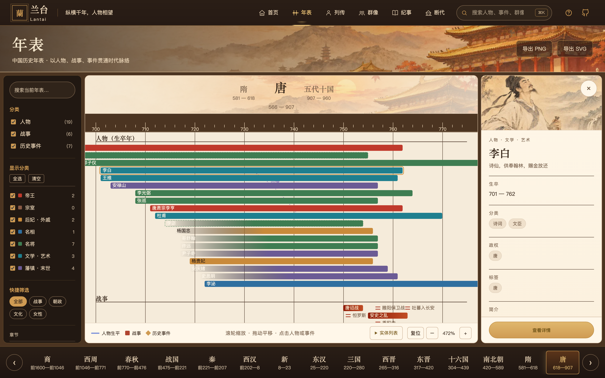

# Lantai · Four Millennia of Chinese History on One Timeline

[](https://github.com/0xenzyme/lantai/actions/workflows/ci.yml)
[](LICENSE)
[](LICENSE-CONTENT.md)

**3,506 historical figures · 708 events · 2070 BCE — 1949 CE**, aligned on a single zoomable, searchable timeline.
Lifelines of people sit next to the wars and events of their time — drag Li Bai next to the An Lushan Rebellion and history becomes a web.

> **Try it live: <https://lantai.0xenzyme.dev>**
> Pure static site, no login required. 中文说明见 [README.md](README.md)。



## Highlights

- **People and events on one axis**: select any person or event and a gold year line anchors everything alive at that moment into one vertical slice. Every viewport and selection is a shareable URL.
- **Adaptive density**: at full span, hundreds of lifelines compress into dense bars; zoom into a narrow window and rows upgrade automatically to "name · dates · lifeline" cards — no manual toggle.
- **Shareable, exportable**: deep links restore viewport, chapter and selection; export the current view as PNG or SVG.
- **Mobile ready**: the primary path works at 375px width with 44px touch targets.
- **One archival design**: a paper, wood and gold "chronicle archive" palette shared by the canvas and every page via a single token map.




## Engineering notes

- **Canvas timeline engine**: [d3-zoom](https://d3js.org/d3-zoom) gestures with a custom lane layout; 4,000+ entries stay smooth across four millennia.
- **Canvas accessibility**: a DOM entity list stays in sync with the viewport, so keyboard and screen-reader users can walk through the real entries in view — where most canvas projects ship nothing.
- **Lean first package**: the boot path loads a lean index under 200KB gzipped; full event lines load on demand with an automatic fallback.
- **Light and static**: runtime dependencies are React plus d3-zoom/scale/selection. No server, no database, no external fonts or third-party scripts; `dist/` self-hosts on any static server (full CSP).
- **Content as code**: one Markdown file per person, JSON Schema validation and lint gates at compile time, same CI as the code.

## Quick start

Requires Node.js 22 or newer.

```bash
npm ci
npm run dev        # http://localhost:5180
npm run build      # type checks + content validation + dist/
npm test
```

## Contributing content

Adding a person is one Markdown file:

```bash
npm run people:new -- <topic> <id>   # scaffolds content/<topic>/<id>.md
# fill in identity, life dates and sources, then:
npm run people:format && npm run content
```

Events and collections work the same way (`events:new` / `collections:new`). The content rules are written in Chinese:

- [内容编写手册](pipeline/PLAYBOOK.md) — admission, date accuracy (`exact` / `approx` / `disputed` / `unknown`), sources, polity attribution
- [事件线规则](docs/事件线规则.md) — event entities and citation rules
- [CONTRIBUTING.md](CONTRIBUTING.md) — code and docs workflow

Report errors through Issues with checkable sources. Bulk content production runs on an auditable two-session agent pipeline (drafting and independent review stay separate); see [内容工作流](docs/内容工作流.md).

This is an open-collaboration visualization and does not replace professional historical research or primary sources.

## License

- Code: [MIT](LICENSE)
- Original historical copy and structured content: [CC BY-SA 4.0](LICENSE-CONTENT.md)
- Classical texts and third-party material keep their original terms
