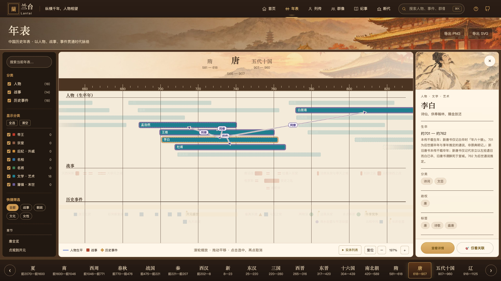
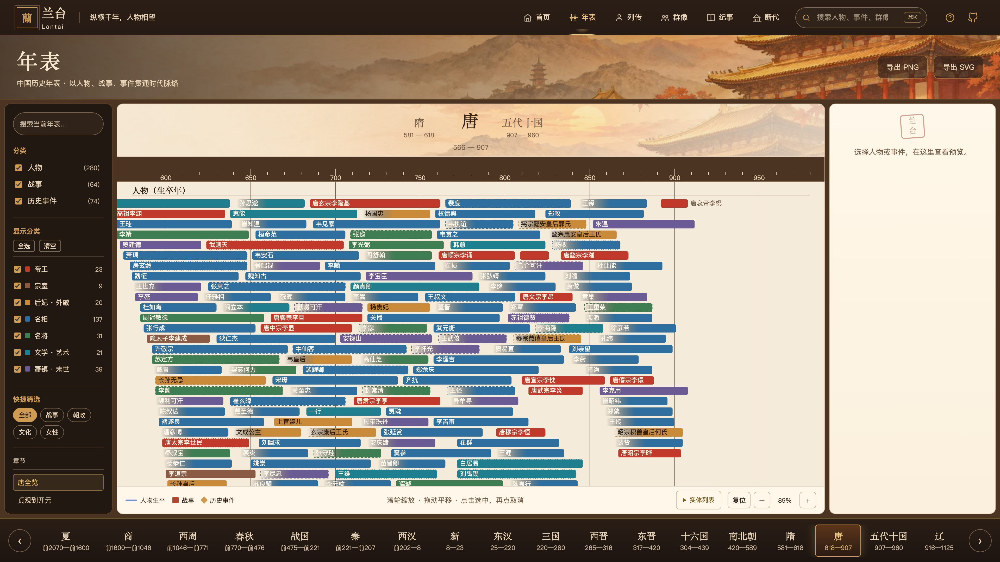

# 兰台 · 四千年中国历史时间轴

[](https://github.com/0xenzyme/lantai/actions/workflows/ci.yml)
[](LICENSE)
[](LICENSE-CONTENT.md)

**3521 位历史人物 · 698 条纪事 · 公元前 2070 — 1949**，放在同一条可缩放、可检索的时间轴上。
人物生平与同时代的战事、事件彼此对齐——把李白拉到安史之乱旁边，历史就成了一张网。

> **在线体验：<https://lantai.0xenzyme.dev>**
> 纯静态站点，无需登录，加载即用。英文说明见 [README.en.md](README.en.md)。



## 为什么值得一看

- **人物与事件同轴**：选中任何人物或事件，画布用金色年份线把同时代的一切锚定在同一个垂直切面。任何视野与选中状态都是一个可分享的 URL。
- **密度自适应**：全景视野下，数百人的生平压缩成密集色条；放大到窄时间窗时，自动升阶为「姓名 · 生卒 · 生命线」的大行视图，无需手动切换。
- **可分享、可导出**：深链精确还原视野、章节与选中状态；当前画面可导出 PNG / SVG。
- **移动端可用**：375px 宽的主路径完整可用，44px 触控目标。
- **统一的典籍设计**：宣纸、深木、沉金的「编年档案馆」配色，画布与页面共用同一套色板 token，不会各画各的。




## 技术亮点

- **Canvas 时间轴引擎**：[d3-zoom](https://d3js.org/d3-zoom) 手势 + 自研泳道布局，全库 4000+ 条目流畅缩放平移。
- **Canvas 无障碍**：维护一个与视口实时同步的 DOM 实体列表，键盘 Tab 与读屏用户可以遍历当前时间窗内的真实条目——多数 Canvas 项目在这里是零。
- **瘦索引首包**：首屏只加载 gzip 合计小于 200KB 的瘦索引与目录，事件线按需加载，失败自动回退全站索引。
- **轻依赖、纯静态**：运行时依赖只有 React 与 d3-zoom/scale/selection，无服务端、无数据库、无外部字体或第三方脚本，`dist/` 可自托管到任意静态服务（CSP 全开）。
- **内容即代码**：每位人物一个 Markdown 文件，编译期 JSON Schema 校验与 lint 门禁，内容与代码走同一套 CI。

## 快速开始

要求 Node.js 22+。

```bash
npm ci
npm run dev        # http://localhost:5180
```

构建与测试：

```bash
npm run build      # 类型检查 + 内容校验 + 产出 dist/
npm test
```

## 贡献内容

新增一位人物只需一个 Markdown 文件：

```bash
npm run people:new -- <topic> <id>   # 生成 content/<topic>/<id>.md 模板
# 编辑身份、生卒、出处后：
npm run people:format && npm run content
```

事件、群像同理（`events:new` / `collections:new`）。收录口径、年份精度（`exact` / `approx` / `disputed` / `unknown`）与政权归属规则见：

- [内容编写手册](pipeline/PLAYBOOK.md)：人物收录、生卒精度、出处、polity 归属
- [事件线规则](docs/事件线规则.md)：事件实体与引用规则
- [贡献指南](CONTRIBUTING.md)：代码与文档贡献流程

发现内容错漏，欢迎通过 Issue 提供条目、问题与可核查出处。批量内容生产使用可审计的双会话 agent 流水线（起草与独立审核分离），细节见[内容工作流](docs/内容工作流.md)。

本项目是开放协作的历史可视化，不替代专业历史研究或原始史料。

## 许可证

- 代码：[MIT](LICENSE)
- 原创历史文案、结构化历史内容与说明文档：[CC BY-SA 4.0](LICENSE-CONTENT.md)
- 古籍原文、第三方材料与依赖仍遵循各自原有条款
